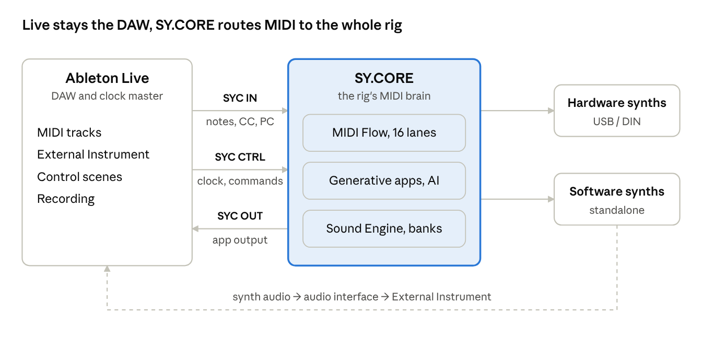

# SY.CORE Live

*The MIDI brain of your rig, next to Ableton Live*

November 4, 2026, updated November 5, 2026 · Online version: https://claude.ai/artifact/HW1Hr9GHfMYk7pxcBc78sc

## In short

SY.CORE Live turns SY.CORE into the MIDI control center of a rig built around Ableton Live. Live stays the DAW, for recording, arranging and mixing. SY.CORE handles everything else: routing, hardware and software synths, generative sequencers, AI and sync.

The result is a rig with no VST plugins inside Live. The synths play their real sounds and get them back when the project is reopened; patterns change during playback, in time with Live.

**Who it is for:** musicians who play live or jam with hardware synths, and audio engineers who must make that rig reliable and repeatable.

**Status:** SY.CORE exists and is in use today. Part of the routing described here already works; the tight integration with Live is in development. The *Status and roadmap* section lists what is available today and what is coming.

## The problem: the MIDI layer of the rig

Live's audio engine, Session View and recording work very well. The weak spot is everything around them: how MIDI reaches the synths, how the synths remember their sounds, how everything stays in time, and what happens when something breaks.

| Area | What happens today with Live alone | Effect on stage or in the studio |
| --- | --- | --- |
| Routing | Each track listens to one port and one channel; splits, layers and fanout need several armed tracks, Instrument Racks or Max for Live | During a jam, changing who plays what means re-arming tracks |
| Hardware synths | Live does not save the state of hardware sounds; Program Changes are numbers without names; no SysEx without Max for Live | A project reopened months later no longer sounds the same |
| Plugins | Every VST runs inside Live's process, with no sandboxing | One plugin crash stops the whole set |
| Sync | Live following an external clock wobbles; clock out to several devices must be tuned port by port | Drifting phase, starts off the beat |
| Generation | Live 12's MIDI Generators work on clips while you edit them, not while the song plays | No patterns that evolve live without extra tools |
| Recording | Tracks, inputs and monitoring must be set up by hand for each source; MIDI round-trip latency is hard to measure | Lost ideas and parts recorded off the grid |

None of these limits concern audio quality. They concern the rig, and that is the space SY.CORE fills.

## The solution: Live plays, SY.CORE routes

Live stays the DAW and the clock master. SY.CORE receives MIDI from Live, routes it to synths and apps, and sends what the apps play back to Live.

Three virtual MIDI ports connect the two programs. SY.CORE owns the hardware synths' ports and Live only sees the virtual ports: no conflicts and no double paths.

| Port | Direction | What it carries |
| --- | --- | --- |
| `SYC IN` | Live → SY.CORE | Up to 16 channels of notes, CC and Program Change from Live's tracks |
| `SYC CTRL` | Live → SY.CORE | Clock, Start/Stop, song position and commands to the apps; never reaches the synths |
| `SYC OUT` | SY.CORE → Live | What the apps play, for recording in Live |

## For musicians

Press Play in Live and SY.CORE's apps play along: chords, drums, bass and sequences are live instruments, not clips to drag around.

- **Generative apps in time with Live.** Chord Sequencer, Drum Machine with Bass Line, Sequencer and Arpeggiator follow Live's clock and restart from the right bar when you move the position.
- **Eight slots per app, A–H.** Each slot is a variation of the pattern; the switch happens on the next bar, as in Session View.
- **Generation during playback.** Generate and Mutate create a new variation with the built-in styles, the Euclidean algorithm or AI, without stopping the music.
- **Song Composer.** From a key, a style and a tempo comes a whole song: sections, chords, drums, bass, sequences and suggested presets for your synths.
- **Live's scenes become song sections.** Launching a scene switches the slots of every app and the synths' sounds together.
- **Control from clips.** A control track in Live selects slots, fires Fill and Repeater, and transposes the key. These actions are recorded and automated like any clip.
- **One keyboard for the whole rig.** Splits, layers and Note Latch for holding a drone are set up once in SY.CORE and recalled per song.
- **Your synths' real sounds.** You hear ideas on the rig straight away, not on General MIDI. On the Roland S-1, Sound Engine presets load via CC onto the current preset, with no Program Change.
- **Live's own instruments too.** Wavetable, Drift, Operator, Simpler and Drum Rack stay available. Live's clips play them as always, and SY.CORE's apps can play them through `SYC OUT`, on their own or layered with a hardware synth.

## For audio engineers

The rig becomes a system with clear rules: who owns which port, who is clock master, how much latency there is, and what happens if one piece fails.

| Topic | How SY.CORE Live handles it |
| --- | --- |
| MIDI ports | SY.CORE owns the hardware ports; Live only sees three virtual ports. No conflicts on Windows' non-multi-client ports, no double paths |
| Routing | MIDI Flow: a visual canvas with 16 lanes for Live's channels, cables to synths and apps, note ranges, channel filters, multi-channel fanout for multitimbral synths |
| Clock | Live is always master, which avoids its unstable slave mode. SY.CORE follows, with a phase lock every bar and Song Position Pointer |
| Clock loss | If Live crashes, SY.CORE can either stop or carry on with its internal clock at the last BPM and re-lock at the next Play |
| Latency | A round-trip test (loopback ping) measures the Live → SY.CORE → Live trip and suggests the values to enter in Live: Sync Delay and Hardware Latency |
| Sound recall | Each Program Change from Live follows a per-device rule: passed through, translated with banks and patch names, or applied as a CC configuration (Roland S-1) |
| Plugins | No third-party VSTs required in Live: MIDI tracks, External Instrument and, if you like, Live's own instruments. Software synths run standalone: if one crashes, Live carries on |
| Feedback loops | A port-by-port documented configuration and loop detection in SY.CORE |
| Repeatability | One Flow configuration per Live set, a Live Set template, and a wizard that checks ports, clock and latency before the session |

During the show, a dedicated Live Rig view shows the clock, lane activity and warnings (port gone, loop, clock lost), with only the controls that matter on stage: lane mute, panic, and a switch to the internal clock.

## Rig Performance Mode

The rig is played in scenes: each app is a track, each slot A–H a clip, each section a scene that changes patterns, sounds and routing together, in time with Live.

**A controller for the rig, not for the instruments.** A slot grid for Chord, Drum, Bass, Seq and Arp, the song's sections, splits and lane mutes, Fill, Repeat and Latch. Panic and the switch to the internal clock fire on hold. The controller always mirrors SY.CORE's state, so after a disconnect it gets back in line by itself. It works with controllers many people already own, such as a Launchpad or an AKAI MIDImix.

**Four options per track** decide how and when a slot starts:

| Option | Values |
| --- | --- |
| Press | Retrigger, Hold & stop, Hold & motion, Latch |
| Motion (when a slot ends) | Stay, One shot, March & wrap / stay / stop, Random, Exclusive random |
| Trigger sync | Off, 1/4 beat to 4 beats, Auto, Queue, Tolerant |
| Position sync | Off, 1/4 beat to 4 beats, Auto |

**Rig scenes.** A slot remembers its part's sound: a Sound Engine preset or a patch from the synth's banks. A scene remembers each app's slot, the MIDI Flow configuration, the split, lane mutes and controller values. You program it once, by capturing the rig's state, and recall it from Live, from the timeline or from the controller.

**From Live.** In the arrangement, one control clip per section is enough: its note recalls the scene. With notes as long as the section and Live's MIDI note chase, starting mid-song puts the rig straight into the right section. With Max for Live, Live's locators can be used directly by name; without a DAW, SY.CORE's Live Timeline does the job.

It is the Session View model, applied where Live can't reach: generative patterns rewritten while the song plays, and the hardware rig.

## Usage scenarios

Five real situations, from the stage to the studio.

**Hybrid live set.** A 45-minute set with Live, a Roland S-1, a multitimbral module and a standalone software synth, with no VSTs in Live. Each Live scene is a section of the song: launching it changes chords, drums, bass and sounds together. Live's clips play leads and pads; SY.CORE sends them to the right synths.

**A studio jam that is always recording.** You play the keyboard, SY.CORE generates chords and drums. The Live tracks that receive the apps' output are always armed, and SY.CORE's MIDI Capture records in parallel as a safety net. When the idea works, a generated variation comes in on the next bar and ends up in the recording.

**Writing with AI.** You start from a key, a style and a tempo. The Song Composer proposes a complete song and the sounds for your synths; you hear it on the rig straight away, refine it in SY.CORE's editors and record it into Live, or drag in the MIDI files.

**Total recall.** You reopen a project months later. The first clip of each track sends a Program Change, and SY.CORE brings every synth back to the saved sound: by bank and patch name, or as a CC configuration on the Roland S-1.

**Live crashes, the music goes on.** On stage, Live closes in the middle of a song. SY.CORE carries on with its internal clock: drums, bass and chords on the hardware synths don't stop. You restart Live, press Play, and the rig locks back in.

## Compared with AI MIDI generator plugins

AI generator plugins produce clips to drag into a track; SY.CORE Live plays, generates and changes parts while the song runs, on your rig's synths.

| | AI generator plugin | SY.CORE Live |
| --- | --- | --- |
| Result | MIDI clips to drag | Clips and live playback, in time, with changes on the bar |
| When it generates | Outside playback, one prompt at a time | Also during playback, with built-in generators or AI |
| Parts | Usually one at a time | Coherent chords, drums, bass and sequences, by section |
| Instruments | Whatever is loaded in the DAW | Any hardware or software synth in the rig |
| Sounds | Does not know your synths' presets | Picks presets from your synths' banks |
| In the DAW | A VST or AU plugin | No plugin: MIDI tracks and External Instrument |
| AI | The product's own service | The provider you choose, with your own key; built-in generators work offline |

The comparison covers the product category. The features of individual plugins change from version to version.

## Requirements and setup

You need Ableton Live 12 (Standard or Suite), Chrome or Edge, and three virtual MIDI ports. SY.CORE needs no installation: it opens in the browser.

| | Windows | macOS |
| --- | --- | --- |
| Browser | Up-to-date Chrome or Edge | Up-to-date Chrome or Edge |
| Virtual MIDI ports | loopMIDI (free) | IAC Driver, built into the system |
| Audio driver | The audio interface's ASIO driver | None (Core Audio) |
| Optional: browser audio into Live | VB-Cable | BlackHole |

**One-time setup:**

1. Create three virtual ports with these names: `SYC IN` (notes and controls from Live's tracks), `SYC CTRL` (clock and commands to the apps), `SYC OUT` (app output back to Live, for recording).
2. In Live, Preferences › Link, Tempo & MIDI: enable `SYC IN` and `SYC CTRL` as outputs only, with clock (Sync, type Song) on `SYC CTRL`; enable `SYC OUT` as an input only. Disable the hardware synths' ports in Live.
3. Open the SY.CORE Live Set template, with tracks, External Instrument devices and scenes ready to go.
4. In SY.CORE, the wizard registers the ports, sets Live as the clock source, loads the MIDI Flow configuration and measures the latency to copy into Live.

Max for Live is not required. It is only needed for the optional extensions.

## Status and roadmap

Routing already works today; tight sync with Live and control from clips arrive with the first version of SY.CORE Live.

| Stage | What it includes |
| --- | --- |
| **Available today** | MIDI Flow with routing between devices and apps, splits, channel filters and multi-channel fanout; Note Latch; MIDI Actions from a controller; Multi Sound banks and the Sound Engine; built-in generators, AI and the Song Composer; MIDI file export to drag into Live |
| **First version (MVP)** | SY.CORE follows Live's clock with phase lock and Song Position Pointer; keeps playing if the clock is lost; Ableton Live node in MIDI Flow with an inspector; per-device Program Change rules; Control Map from Live's clips; app output back to Live with compensated latency; Live Set template, wizard and Live Rig view |
| **Right after** | Live scenes as Song Composer sections; AI that takes the rig's synths and presets into account |
| **Rig Performance Mode** | Rig Controller with Launchpad Mini MK1 and AKAI MIDImix, per-track performance options, rig scenes recalled from Live, the timeline or the controller, with chase. A UI prototype already exists on a development branch |
| **Optional extensions** | A Max for Live device to read key, scenes and locators from Live and write clips straight into its slots; OSC for tablet surfaces; Ableton Link; a Push script; a desktop app that creates the virtual ports by itself |

## Principles

SY.CORE extends an instrument's voice, it doesn't replace it. SY.CORE Live applies the same principle to Ableton Live.

- **Local-first.** Patterns, presets, routing and mappings stay on the computer in front of you. No internet is needed at show time; AI is an option, and the built-in generators work offline.
- **No required plugins.** The base rig needs only the browser and three virtual MIDI ports. Max for Live, Ableton Link and the desktop app are extensions, never requirements.
- **Open source.** The code is MIT-licensed: it can be read, checked and extended to other instruments.
- **Donationware.** No Pro version and no locked features: donations are a thank-you, not a toll.
