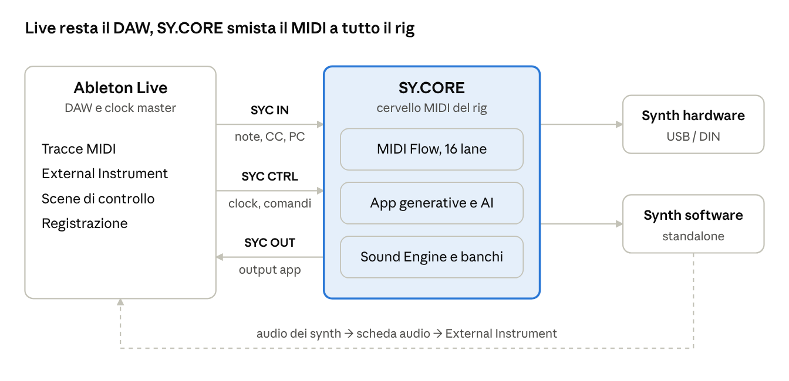

# SY.CORE Live

*Il cervello MIDI del tuo rig, accanto ad Ableton Live*

4 novembre 2026, aggiornato il 5 novembre 2026 · Versione online: https://claude.ai/artifact/DNV5wTdE2hesCpcK2qNDno

## In breve

SY.CORE Live trasforma SY.CORE nel centro di controllo MIDI di un rig costruito intorno ad Ableton Live. Live resta il DAW, per registrare, arrangiare e mixare. SY.CORE gestisce tutto il resto: routing, synth hardware e software, sequencer generativi, AI e sync.

Il risultato è un rig senza plugin VST dentro Live. I synth suonano con i loro suoni veri e li ritrovano alla riapertura del progetto; i pattern cambiano durante la riproduzione, a tempo con Live.

**Per chi è:** musicisti che suonano dal vivo o in jam con synth hardware, e tecnici audio che devono rendere quel rig affidabile e ripetibile.

**Stato:** SY.CORE esiste ed è usato oggi. Una parte del routing descritto qui funziona già; l'integrazione stretta con Live è in sviluppo. Il paragrafo *Stato e roadmap* indica cosa è disponibile oggi e cosa arriverà.

## Il problema: il livello MIDI del rig

Il motore audio di Live, la Session View e la registrazione funzionano molto bene. Il punto debole è tutto ciò che sta intorno: come il MIDI arriva ai synth, come i synth ricordano i loro suoni, come tutto resta a tempo e cosa succede quando qualcosa si rompe.

| Area | Cosa succede oggi con Live da solo | Effetto sul palco o in studio |
| --- | --- | --- |
| Routing | Ogni traccia ascolta una porta e un canale; split, layer e fanout richiedono più tracce armate, Instrument Rack o Max for Live | Durante una jam, cambiare chi suona cosa significa ri-armare tracce |
| Synth hardware | Live non salva lo stato dei suoni hardware; i Program Change sono numeri senza nomi; niente SysEx senza Max for Live | Un progetto riaperto dopo mesi non suona più come prima |
| Plugin | Tutti i VST girano nel processo di Live, senza isolamento | Un plugin che si blocca ferma il set intero |
| Sync | Live che segue un clock esterno oscilla; il clock verso più dispositivi va regolato porta per porta | Fasi che scivolano, partenze fuori battuta |
| Generazione | I generatori MIDI di Live 12 lavorano sulle clip mentre le modifichi, non mentre il brano suona | Nessun pattern che evolve dal vivo senza strumenti aggiuntivi |
| Registrazione | Tracce, ingressi e monitoring vanno preparati a mano per ogni sorgente; la latenza del giro MIDI non si misura facilmente | Idee perse e parti registrate fuori griglia |

Nessuno di questi limiti riguarda la qualità audio. Riguardano il rig: è lo spazio che SY.CORE occupa.

## La soluzione: Live suona, SY.CORE smista

Live resta il DAW e il clock master. SY.CORE riceve il MIDI da Live, lo smista a synth e app, e rimanda a Live quello che le app suonano.

Tre porte MIDI virtuali collegano i due programmi. SY.CORE possiede le porte dei synth hardware e Live vede solo le porte virtuali: niente conflitti e niente percorsi doppi.

| Porta | Direzione | Cosa trasporta |
| --- | --- | --- |
| `SYC IN` | Live → SY.CORE | Fino a 16 canali di note, CC e Program Change dalle tracce di Live |
| `SYC CTRL` | Live → SY.CORE | Clock, Start/Stop, posizione nel brano e comandi alle app; non arriva mai ai synth |
| `SYC OUT` | SY.CORE → Live | Quello che suonano le app, per registrarlo in Live |

## Per il musicista

Premi Play in Live e le app di SY.CORE suonano con te: accordi, batteria, basso e sequenze sono strumenti vivi, non clip da trascinare.

- **App generative a tempo con Live.** Chord Sequencer, Drum Machine con Bass Line, Sequencer e Arpeggiator seguono il clock di Live e ripartono dalla battuta giusta quando sposti la posizione.
- **Otto slot per app, A–H.** Ogni slot è una variante del pattern; il cambio avviene alla battuta successiva, come nella Session View.
- **Generazione durante la riproduzione.** Generate e Mutate creano una nuova variante con gli stili integrati, l'algoritmo euclideo o l'AI, senza fermare la musica.
- **Song Composer.** Da tonalità, stile e tempo nasce un brano intero: sezioni, accordi, batteria, basso, sequenze e i preset suggeriti per i tuoi synth.
- **Le scene di Live diventano sezioni del brano.** Lanciare una scena cambia insieme gli slot di tutte le app e i suoni dei synth.
- **Controllo dalle clip.** Una traccia di controllo in Live seleziona slot, lancia Fill e Repeater, trasporta la tonalità. Le azioni si registrano e si automatizzano come qualsiasi clip.
- **Una tastiera per tutto il rig.** Split, layer e Note Latch per tenere un drone si configurano una volta in SY.CORE e si richiamano per brano.
- **I suoni veri dei tuoi synth.** Ascolti le idee subito sul rig, non su un General MIDI. Sul Roland S-1 i preset del Sound Engine si caricano via CC sul preset corrente, senza Program Change.
- **Anche con gli strumenti di Live.** Wavetable, Drift, Operator, Simpler e Drum Rack restano a disposizione. Le clip di Live li suonano come sempre, e le app di SY.CORE possono suonarli attraverso `SYC OUT`, da sole o in layer con un synth hardware.

## Per il tecnico audio

Il rig diventa un sistema con regole chiare: chi possiede quale porta, chi è master del clock, quanto vale la latenza e cosa succede se un pezzo cade.

| Tema | Come lo gestisce SY.CORE Live |
| --- | --- |
| Porte MIDI | SY.CORE possiede le porte hardware; Live vede solo tre porte virtuali. Niente conflitti sulle porte non multi-client di Windows, niente doppi percorsi |
| Routing | MIDI Flow: un canvas visuale con 16 lane per i canali di Live, cavi verso synth e app, note range, filtri di canale, fanout multicanale per i multitimbrici |
| Clock | Live è sempre master, quindi si evita la sua modalità slave instabile. SY.CORE segue con aggancio della fase a ogni battuta e Song Position Pointer |
| Perdita del clock | Se Live si blocca, SY.CORE può fermarsi o continuare con il clock interno all'ultimo BPM e riagganciarsi al Play successivo |
| Latenza | Un test di andata e ritorno (loopback ping) misura il giro Live → SY.CORE → Live e propone i valori da inserire in Live: Sync Delay e Hardware Latency |
| Recall dei suoni | Ogni Program Change da Live segue una regola per dispositivo: inoltrato, tradotto con i banchi e i nomi delle patch, oppure applicato come configurazione di CC (Roland S-1) |
| Plugin | In Live nessun VST di terze parti obbligatorio: tracce MIDI, External Instrument e, se vuoi, gli strumenti nativi di Live. I synth software girano standalone: se uno si blocca, Live continua |
| Loop di feedback | Configurazione documentata porta per porta e rilevamento dei loop in SY.CORE |
| Ripetibilità | Una configurazione di Flow per ogni set di Live, un template di Live Set e un wizard che verifica porte, clock e latenza prima della sessione |

Durante lo show una vista dedicata, Live Rig, mostra clock, attività delle lane e avvisi (porta sparita, loop, clock perso), con i soli comandi utili sul palco: mute delle lane, panico, passaggio a clock interno.

## Rig Performance Mode

Il rig si suona a scene: ogni app è una traccia, ogni slot A–H una clip, ogni sezione una scena che cambia insieme pattern, suoni e routing, a tempo con Live.

**Un controller del rig, non degli strumenti.** Una griglia di slot per Chord, Drum, Bass, Seq e Arp, le sezioni del brano, split e mute delle lane, Fill, Repeat e Latch. Panico e passaggio al clock interno si attivano tenendo premuto. Il controller mostra sempre lo stato di SY.CORE, quindi dopo uno scollegamento torna allineato da solo. Funziona con controller che molti hanno già, come un Launchpad o un AKAI MIDImix.

**Quattro opzioni per traccia** decidono come e quando uno slot parte:

| Opzione | Valori |
| --- | --- |
| Press | Retrigger, Hold & stop, Hold & motion, Latch |
| Motion (a fine slot) | Stay, One shot, March & wrap / stay / stop, Random, Exclusive random |
| Trigger sync | Off, da 1/4 di beat a 4 beat, Auto, Queue, Tolerant |
| Position sync | Off, da 1/4 di beat a 4 beat, Auto |

**Scene del rig.** Uno slot ricorda il suono della sua parte: un preset del Sound Engine o una patch dei banchi del synth. Una scena ricorda gli slot di ogni app, la configurazione di MIDI Flow, lo split, i mute delle lane e i valori dei controller. Si programma una volta, catturando lo stato del rig, e si richiama da Live, dalla timeline o dal controller.

**Da Live.** Nell'arrangement basta una clip di controllo per sezione: la sua nota richiama la scena. Con note lunghe quanto la sezione e il chase delle note di Live, ripartendo a metà brano il rig si trova già nella sezione giusta. Con Max for Live si potranno usare direttamente i locator di Live per nome; senza DAW si usa la Live Timeline di SY.CORE.

È lo stesso modello della Session View, applicato a ciò che Live non raggiunge: pattern generativi riscritti mentre il brano suona e il rig hardware.

## Scenari d'uso

Cinque situazioni reali, dal palco allo studio.

**Live set ibrido.** Un set di 45 minuti con Live, un Roland S-1, un modulo multitimbrico e un synth software standalone, senza VST in Live. Ogni scena di Live è una sezione del brano: lanciarla cambia accordi, batteria, basso e suoni insieme. Le clip di Live suonano lead e pad; SY.CORE le smista ai synth giusti.

**Jam in studio sempre in registrazione.** Suoni la tastiera, SY.CORE genera accordi e batteria. Le tracce di Live che ricevono l'output delle app sono sempre armate, e la MIDI Capture di SY.CORE registra in parallelo come rete di sicurezza. Quando l'idea gira, una variante generata entra alla battuta successiva e finisce nella registrazione.

**Scrittura con l'AI.** Parti da tonalità, stile e tempo. Il Song Composer propone un brano completo e i suoni per i tuoi synth; lo ascolti subito sul rig, lo correggi negli editor di SY.CORE e lo registri in Live, oppure trascini i file MIDI.

**Total recall.** Riapri un progetto dopo mesi. La prima clip di ogni traccia manda un Program Change, e SY.CORE riporta ogni synth al suono salvato: per banco e nome della patch, o come configurazione di CC sul Roland S-1.

**Live si blocca, la musica continua.** Sul palco Live si chiude a metà brano. SY.CORE prosegue con il clock interno: batteria, basso e accordi sui synth hardware non si fermano. Riavvii Live, premi Play e il rig si riaggancia.

## Rispetto ai generatori MIDI AI in plugin

I generatori AI in plugin producono clip da trascinare in una traccia; SY.CORE Live suona, genera e cambia le parti mentre il brano va, sui synth del tuo rig.

| | Generatore AI in plugin | SY.CORE Live |
| --- | --- | --- |
| Risultato | Clip MIDI da trascinare | Clip e riproduzione dal vivo, a tempo, con cambi alla battuta |
| Quando genera | Fuori dalla riproduzione, un prompt alla volta | Anche durante la riproduzione, con generatori integrati o AI |
| Parti | Di solito una per volta | Accordi, batteria, basso e sequenze coerenti, per sezioni |
| Strumenti | Quelli caricati nel DAW | Qualsiasi synth hardware o software del rig |
| Suoni | Non conosce i preset dei tuoi synth | Sceglie i preset dai banchi dei tuoi synth |
| Nel DAW | Un plugin VST o AU | Nessun plugin: tracce MIDI e External Instrument |
| AI | Il servizio del prodotto | Il provider che scegli, con la tua chiave; generatori integrati senza rete |

Il confronto riguarda la categoria di prodotto. Le funzioni dei singoli plugin cambiano da versione a versione.

## Requisiti e configurazione

Servono Ableton Live 12 (Standard o Suite), Chrome o Edge e tre porte MIDI virtuali. SY.CORE non si installa: si apre nel browser.

| | Windows | macOS |
| --- | --- | --- |
| Browser | Chrome o Edge aggiornato | Chrome o Edge aggiornato |
| Porte MIDI virtuali | loopMIDI (gratuito) | IAC Driver, già incluso nel sistema |
| Driver audio | ASIO della scheda audio | Nessuno (Core Audio) |
| Opzionale: audio del browser in Live | VB-Cable | BlackHole |

**Configurazione, una volta sola:**

1. Crea tre porte virtuali con questi nomi: `SYC IN` (note e controlli dalle tracce di Live), `SYC CTRL` (clock e comandi alle app), `SYC OUT` (output delle app verso Live, per registrare).
2. In Live, Preferences › Link, Tempo & MIDI: attiva `SYC IN` e `SYC CTRL` solo in uscita, con il clock (Sync, tipo Song) su `SYC CTRL`; attiva `SYC OUT` solo in ingresso. Disattiva in Live le porte dei synth hardware.
3. Apri il template di Live Set di SY.CORE Live, con tracce, External Instrument e scene già pronti.
4. In SY.CORE il wizard registra le porte, imposta Live come sorgente del clock, carica la configurazione di MIDI Flow e misura la latenza da copiare in Live.

Max for Live non è richiesto. Serve solo per le estensioni opzionali.

## Stato e roadmap

Il routing funziona già oggi; il sync stretto con Live e il controllo dalle clip arrivano con la prima versione di SY.CORE Live.

| Fase | Cosa comprende |
| --- | --- |
| **Disponibile oggi** | MIDI Flow con routing tra dispositivi e app, split, filtri di canale e fanout multicanale; Note Latch; MIDI Actions da un controller; banchi Multi Sound e Sound Engine; generatori integrati, AI e Song Composer; export in file MIDI da trascinare in Live |
| **Prima versione (MVP)** | SY.CORE segue il clock di Live con aggancio della fase e Song Position Pointer; continuità se il clock si perde; nodo Ableton Live in MIDI Flow con inspector; Program Change per dispositivo; Control Map dalle clip di Live; ritorno dell'output a Live con latenza compensata; template di Live Set, wizard e vista Live Rig |
| **Subito dopo** | Scene di Live come sezioni del Song Composer; AI che tiene conto dei synth e dei preset del rig |
| **Rig Performance Mode** | Rig Controller con Launchpad Mini MK1 e AKAI MIDImix, opzioni di performance per traccia, scene del rig richiamate da Live, dalla timeline o dal controller, con chase. Un prototipo dell'interfaccia esiste già su un branch di sviluppo |
| **Estensioni opzionali** | Device Max for Live per leggere tonalità, scene e locator da Live e scrivere clip direttamente negli slot; OSC per superfici su tablet; Ableton Link; script per Push; app desktop che crea da sola le porte virtuali |

## Principi

SY.CORE estende la voce degli strumenti, non la sostituisce. SY.CORE Live applica lo stesso principio ad Ableton Live.

- **Local-first.** Pattern, preset, routing e mappature restano sul computer davanti a te. Al momento dello show non serve internet; l'AI è un'opzione, i generatori integrati funzionano senza rete.
- **Nessun plugin obbligatorio.** Il rig base richiede solo il browser e tre porte MIDI virtuali. Max for Live, Ableton Link e l'app desktop sono estensioni, mai requisiti.
- **Open source.** Il codice è sotto licenza MIT: si può leggere, verificare ed estendere ad altri strumenti.
- **Donationware.** Nessuna versione Pro e nessuna funzione bloccata: le donazioni sono un ringraziamento, non un pedaggio.
